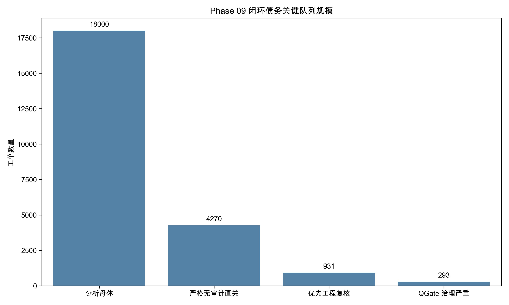
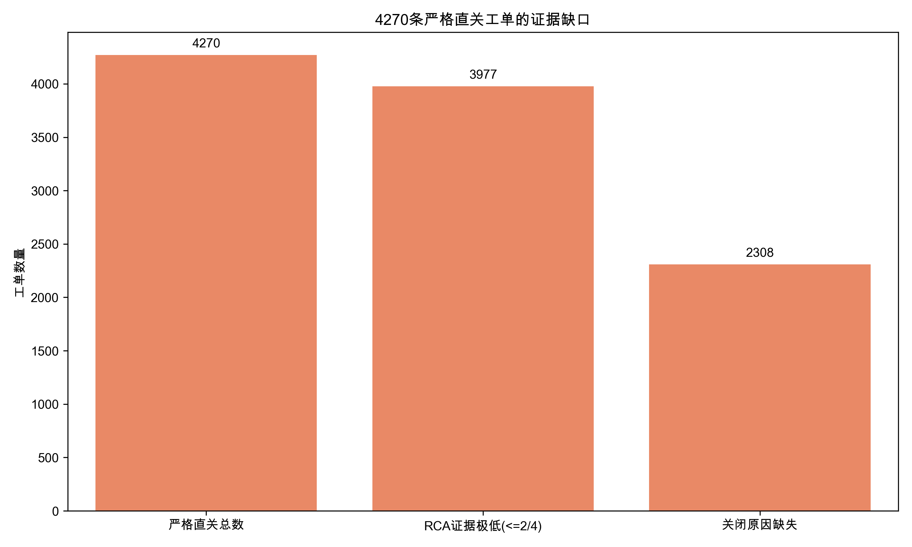
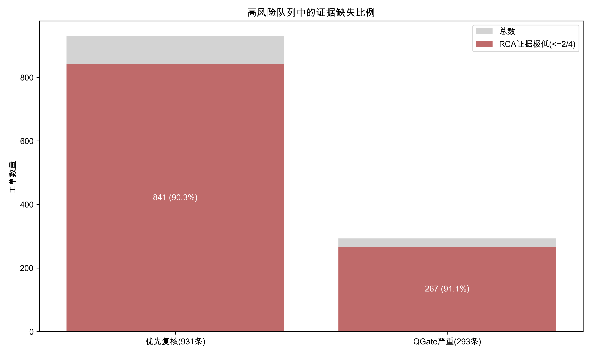
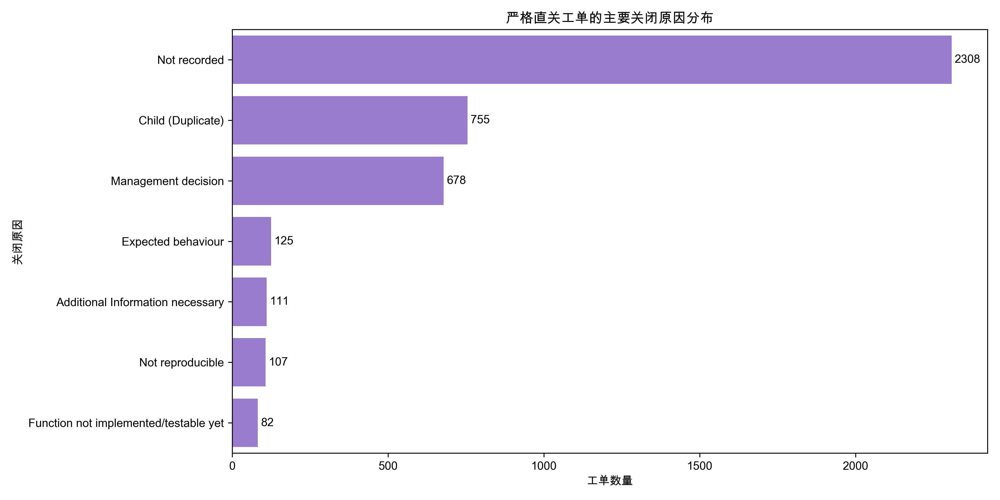
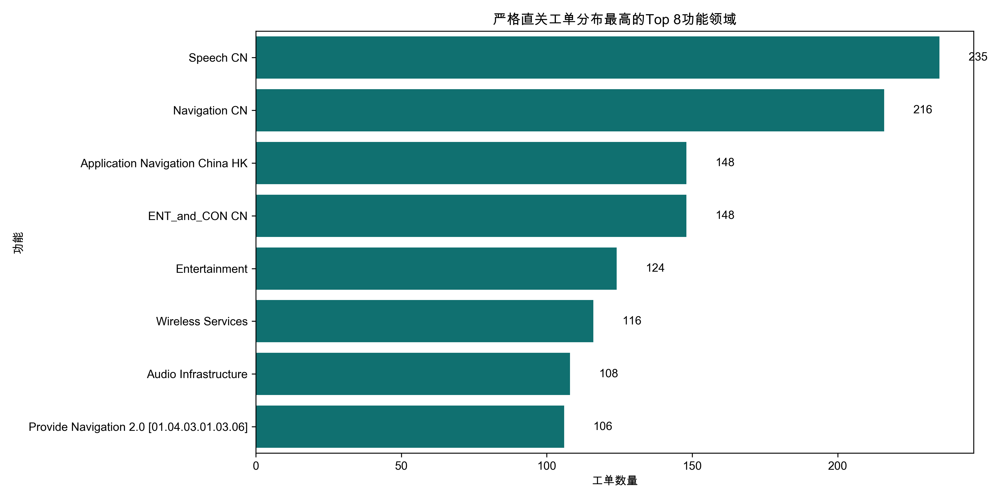

# IDCEVO Phase 09 研发闭环质量分析自动生成报告

根据 [2026-09-07 FinalProject 工作簿] 提取并清洗数据，自动生成以下统计与图表。

## 1. 闭环债务规模

- **分析母体总数**: 18000
- **严格直关 (直接 01->09 无证据)**: 4270
- **优先工程复核**: 931
- **QGate 治理严重**: 293

## 2. 严格直关的证据缺口

在 4270 条严格直关的工单中，暴露出极大的证据缺失：
- **未记录关闭原因**: 2308 (占比 54.1%)
- **RCA 技术证据极低 (<=2/4)**: 3977 (占比 93.1%)

## 3. 优先复核与严重项的质量画像

研发管理层重点关注的高风险队列中，绝大多数同样缺乏有效的技术举证：
- **优先复核队列 RCA 极低占比**: 90.3%
- **QGate 严重项 RCA 极低占比**: 91.1%

## 4. 关闭原因与工程债务

未提供技术结论和验证而直接关闭，以下是排名前列的伪关闭理由：

## 5. 功能风险入口 (Top 8)

从研发落地路径来看，建议优先对以下功能领域启动专题技术复核：

---
*此报告和图表由 Trae 自动化数据脚本生成。*
